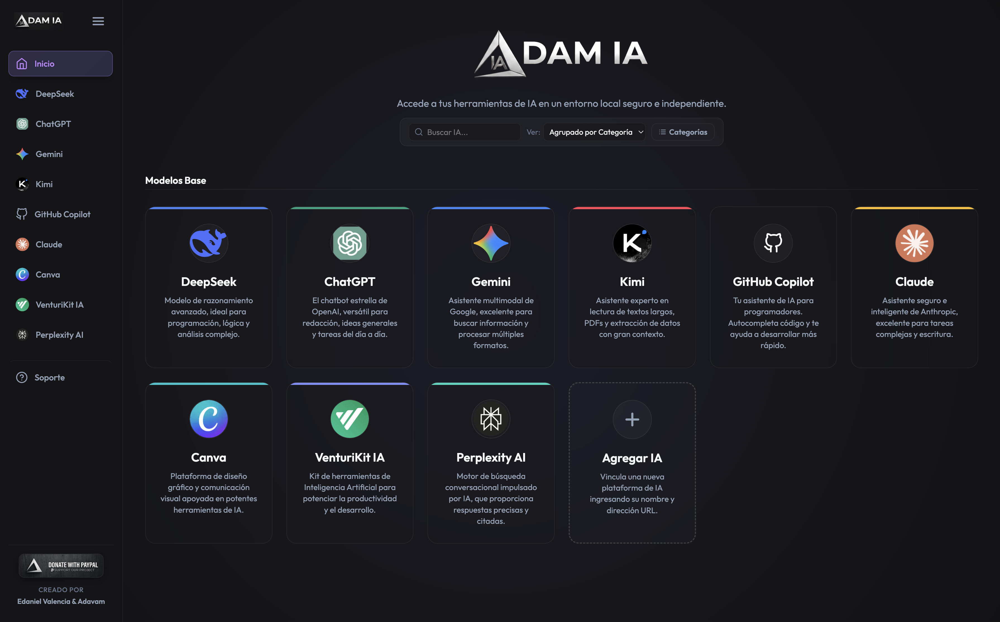

# Adam IA 🚀

<div align="center">
  
  <br><br>
  <a href="https://github.com/adavam/adam-ia/releases/download/RELEASE/Adam.IA.Setup.1.0.7.exe">
    
  </a>
</div>

**Adam IA** es una aplicación de escritorio multiplataforma diseñada para agrupar y organizar tus herramientas de Inteligencia Artificial favoritas en un único panel de control local y seguro. La aplicación te permite chatear de forma independiente con múltiples plataformas y vincular nuevos asistentes personalizados mediante su dirección URL.

---

## 🌟 **Características**

- **Experiencia de Escritorio Unificada**: Accede a todos tus chats de IA en una interfaz de escritorio fluida y premium con un tema oscuro elegante.
- **Plataformas Preinstaladas**:
  - **DeepSeek**
  - **ChatGPT**
  - **Gemini**
  - **Kimi**
- **Vinculación de IAs Personalizadas**: Añade cualquier otra plataforma (como Claude, HuggingChat, Perplexity, etc.) ingresando su nombre, URL y seleccionando un color temático para identificarla.
- **Aislamiento de Sesiones**: Cada herramienta funciona en un entorno aislado (`partition` dedicada), garantizando que las sesiones e inicios de sesión de cada cuenta permanezcan guardados de forma persistente y no entren en conflicto.
- **Navegación Intuitiva**: Barra lateral colapsable, controles de navegación superior (Atrás, Adelante, Recargar) y redirección automática de enlaces a tu navegador externo por seguridad.

---

## 📥 **Cómo Instalar**

### Opción 1: Descargar el Instalador (Recomendado)
1. Descarga el instalador directamente desde las descargas de este repositorio:
   [**Descargar Adam IA 1.0.7 para Windows**](https://github.com/adavam/adam-ia/releases/download/RELEASE/Adam.IA.Setup.1.0.7.exe)
2. Ejecuta el archivo `.exe` y sigue los pasos del asistente de instalación.
3. Abre **Adam IA** y comienza a chatear.

### Opción 2: Compilar desde el Código Fuente (Desarrolladores)
Si deseas ejecutar o compilar el proyecto tú mismo en un entorno local, asegúrate de tener instalados **[Node.js](https://nodejs.org/)** y **[Git](https://git-scm.com/)**. Luego sigue estos pasos:

1. Clona el repositorio:
   ```bash
   git clone https://github.com/adavam/adam-ia.git
   ```
2. Accede al directorio del proyecto:
   ```bash
   cd adam-ia
   ```
3. Instala las dependencias necesarias:
   ```bash
   npm install
   ```
4. Ejecuta la aplicación en modo desarrollo:
   ```bash
   npm start
   ```
5. Genera el instalador empaquetado para distribución (`.exe`):
   ```bash
   npm run build
   ```
   El instalador se generará en la carpeta `dist/`.

#### 🛠️ Solución de Errores al Compilar en Windows (Enlace Simbólico)
Si al ejecutar `npm run build` obtienes un error como:
`ERROR: Cannot create symbolic link : A required privilege is not held by the client.`

Esto ocurre porque `electron-builder` descarga un paquete de firma de código que contiene enlaces simbólicos para macOS. Puedes resolverlo de las siguientes maneras:
* **Activar el Modo de Desarrollador (Recomendado)**: Ve a **Configuración > Sistema > Para programadores** en Windows y activa el **Modo de desarrollador**. Esto permite la creación de enlaces simbólicos sin permisos de administrador.
* **Ejecutar como Administrador**: Abre tu terminal (PowerShell / Command Prompt) o tu editor (VS Code) haciendo clic derecho y seleccionando **Ejecutar como Administrador**, luego ejecuta el build.
* **Extracción manual de caché (Workaround)**: Extrae el archivo `.7z` de la carpeta de caché de `electron-builder` en `C:\Users\<TuUsuario>\AppData\Local\electron-builder\Cache\winCodeSign` a una carpeta llamada `winCodeSign-2.6.0`, excluyendo la carpeta `darwin` (que contiene los enlaces simbólicos de macOS y no se necesita en Windows).

---

## 🛠️ **Requisitos del Sistema**

- **Windows**: Windows 10 o posterior.
- **macOS**: *Próximamente en versión 1.0.8.*
- **Linux**: *Próximamente en versión 1.0.8.*

---

## 📜 **Licencia**

Este proyecto está bajo la Licencia **MIT**. Consulta el archivo [LICENSE](LICENSE) para más detalles.

---

Propiedad de **Edaniel Valencia & Adavam** 🚀. Todos los derechos reservados.
