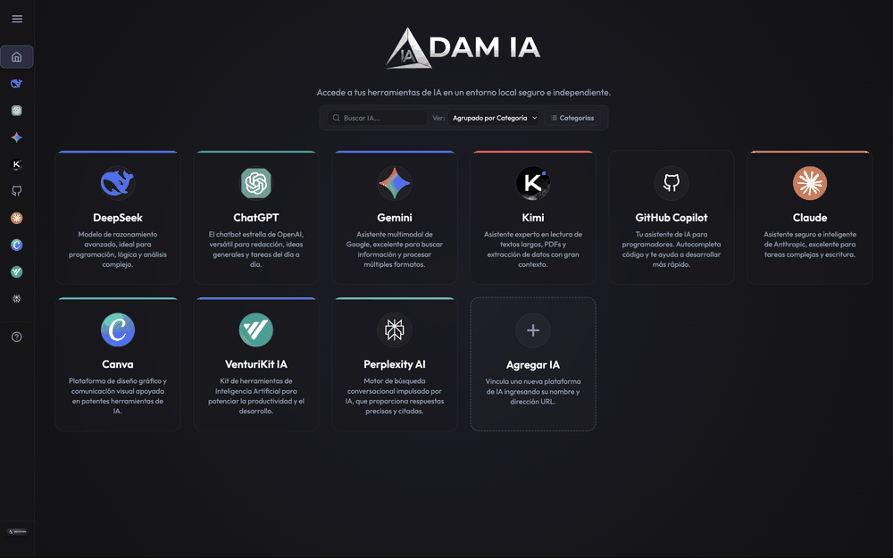

# Adam IA 🚀

<div align="center">
  <a href="README.md">Español</a> | <b>English</b>
  <br><br>
  
</div>

**Adam IA** is a cross-platform desktop application designed to aggregate and organize your favorite Artificial Intelligence tools into a single, secure local control panel. The application allows you to chat independently with multiple AI platforms and link new custom assistants using their web URL address.

---

## 🌟 **Features**

- **Unified Desktop Experience**: Access all your AI chats in a fluid, premium desktop interface with a sleek dark theme.
- **Pre-installed Platforms**:
  - **DeepSeek**
  - **ChatGPT**
  - **Gemini**
  - **Kimi**
  - **GitHub Copilot**
- **Custom AI Integration**: Add any other platform (such as Claude, HuggingChat, Perplexity, etc.) by entering its name, URL, and selecting a theme color for identification.
- **Session Isolation**: Each tool runs in an isolated environment (dedicated `partition`), ensuring that accounts and logins remain saved persistently without conflicting with each other.
- **Intuitive Navigation**: Collapsible sidebar, top navigation controls (Back, Forward, Refresh), and automatic redirection of external links to your default browser for security.

---

## 📥 **How to Install**

### Option 1: Download the Installer (Recommended)

Download the installer for your operating system from the repository releases:

- 🪟 **Windows**: [**Download Adam IA 1.0.7 (.exe)**](https://github.com/edaniel-valencia/Adam-IA/releases/download/1.0.7/Adam.IA.Setup.1.0.7.exe)
- 🍎 **macOS (Apple Silicon - M1/M2/M3/M4)**: [**Download Adam IA 1.0.7 (.dmg ARM64)**](https://github.com/edaniel-valencia/Adam-IA/releases/download/1.0.7/Adam.IA-1.0.7-arm64.dmg)
- 🍏 **macOS (Intel)**: [**Download Adam IA 1.0.7 (.dmg x64)**](https://github.com/edaniel-valencia/Adam-IA/releases/download/1.0.7/Adam.IA-1.0.7.dmg)

---

### Option 2: Build from Source Code (Developers)
If you wish to run or build the project yourself locally, ensure you have **[Node.js](https://nodejs.org/)** and **[Git](https://git-scm.com/)** installed. Then follow these steps:

1. Clone the repository:
   ```bash
   git clone https://github.com/adavam/adam-ia.git
   ```
2. Navigate to the project directory:
   ```bash
   cd adam-ia
   ```
3. Install required dependencies:
   ```bash
   npm install
   ```
4. Run the application in development mode:
   ```bash
   npm start
   ```
5. Generate the packaged installer for distribution (`.exe` / `.dmg`):
   ```bash
   npm run build
   ```
   The output installer will be generated in the `dist/` folder.

---

## 🛠️ **System Requirements**

- **Windows**: Windows 10 or later.
- **macOS**: macOS 10.15 (Catalina) or later (Compatible with Apple Silicon M1/M2/M3/M4 and Intel Processors).
- **Linux**: *Coming soon.*

---

## 📜 **License**

This project is under the **MIT** License. See the [LICENSE](LICENSE) file for details.

---

Property of **Edaniel Valencia & Adavam** 🚀. All rights reserved.
